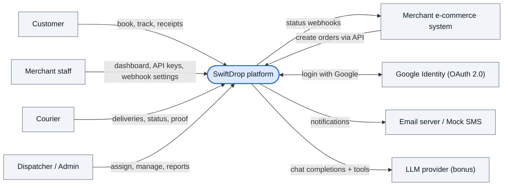
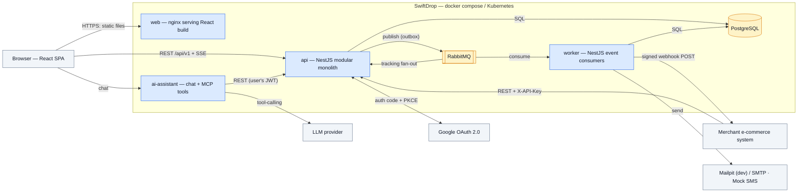
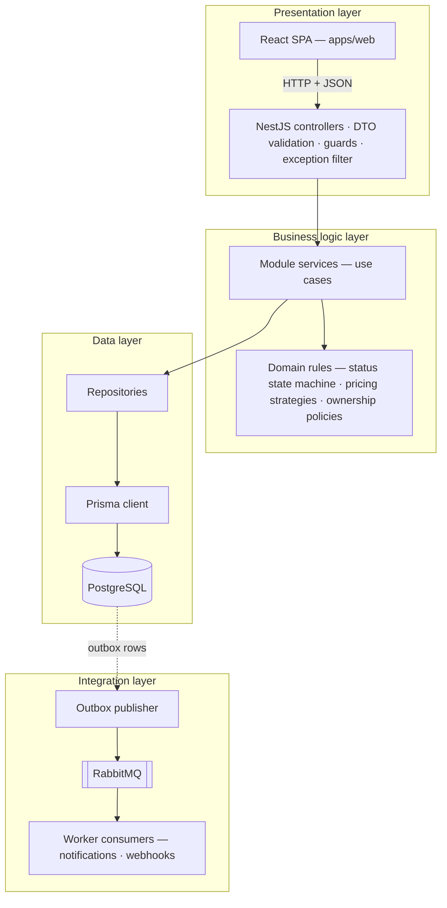
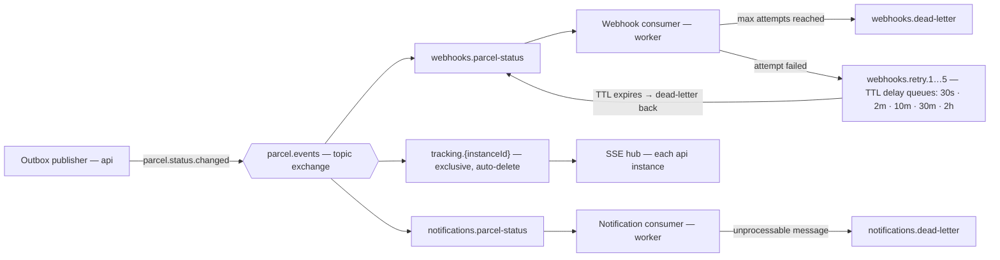
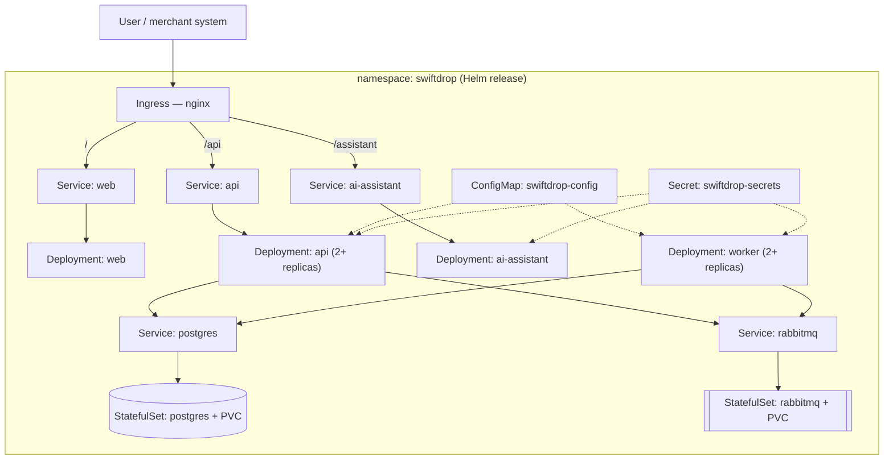
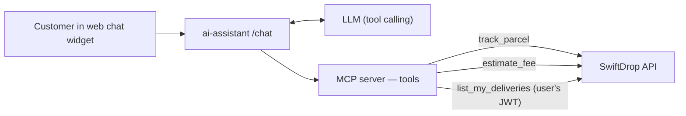

# SwiftDrop — Architecture

> Living document. If you change how the system works, update this file in the same PR.
> Diagrams are Mermaid and render on GitHub. Use case and sequence diagrams are in
> [`docs/diagrams/`](docs/diagrams/README.md).

**Contents**

1. [Goals and constraints](#1-goals-and-constraints)
2. [Architecture style and justification](#2-architecture-style-and-justification)
3. [System context](#3-system-context)
4. [Containers (runtime view)](#4-containers-runtime-view)
5. [Layers](#5-layers)
6. [Backend modules](#6-backend-modules)
7. [Integration design](#7-integration-design)
8. [Real-time tracking](#8-real-time-tracking)
9. [Security](#9-security)
10. [Data model](#10-data-model)
11. [API conventions](#11-api-conventions)
12. [Design patterns and principles](#12-design-patterns-and-principles)
13. [Deployment](#13-deployment)
14. [Testing strategy](#14-testing-strategy)
15. [AI Delivery Assistant (bonus)](#15-ai-delivery-assistant-bonus)
16. [Decision log](#16-decision-log)

---

## 1. Goals and constraints

| Goal | What it means for the design |
|---|---|
| Visibility for customers | Live parcel tracking (SSE) and a public tracking page |
| Merchant integration | Secured REST API with API keys + webhooks with retry |
| Reliability of events | A status change must always produce a notification/webhook, even if RabbitMQ was briefly down → **transactional outbox** |
| Security of personal data | Validation, hashed passwords and keys, RBAC, ownership checks, PII-free logs and errors |
| Team of 10 working in parallel | Clear module boundaries so people rarely edit the same files |
| Runs anywhere | Every service containerised; one `docker compose up` for the whole system; Kubernetes for the bonus |

**Stack:** React + TypeScript · NestJS · PostgreSQL (Prisma) · RabbitMQ · SSE · Docker Compose ·
Kubernetes/Helm (bonus) · MCP-based AI assistant (bonus).

---

## 2. Architecture style and justification

**Chosen style: Modular monolith (NestJS) acting as the BFF + separate asynchronous worker
process + message broker.**

- The **API** is one deployable NestJS app split into business modules (`auth`, `parcels`,
  `pricing`, `dispatch`, …). It serves the React app (Backend-for-Frontend role), the
  merchant API and public tracking.
- The **worker** is a second NestJS app that only consumes RabbitMQ events (notifications,
  webhooks). It deploys and scales independently of the API.
- **RabbitMQ** decouples "something happened" from "who needs to react".

### Why not the alternatives?

| Option | Pros | Cons for this project | Verdict |
|---|---|---|---|
| Classic layered monolith | Simplest | Slow external calls (email, webhooks) would run inside HTTP requests; weak module boundaries for 10 people | ❌ |
| Microservices (one service per domain) | Independent scaling and deployment | Distributed transactions between parcels/pricing/dispatch, many repos/containers, heavy ops load for a semester project | ❌ |
| **Modular monolith + async worker** | One DB transaction for business rules, clear module ownership, async work isolated, easy local setup | Must enforce module boundaries by convention + code review | ✅ |

The module boundaries mean any module (e.g. `pricing`) could later be extracted into its own
service without rewriting callers.

---

## 3. System context

Who and what SwiftDrop talks to.



---

## 4. Containers (runtime view)

Every box inside the dashed area is a Docker container.



| Container | Tech | Responsibility | Scales |
|---|---|---|---|
| `web` | React + TS, built by Vite, served by nginx | UI for all roles + public tracking page | Horizontally (stateless) |
| `api` | NestJS | REST API, auth, business rules, outbox publisher, SSE hub | Horizontally (stateless; SSE fan-out via RabbitMQ) |
| `worker` | NestJS standalone | Notification + webhook consumers, retries | Horizontally (competing consumers) |
| `ai-assistant` | Node + TS, MCP | Chatbot that calls the API as tools | Horizontally |
| `postgres` | PostgreSQL 16 | System of record | Single instance (volume) |
| `rabbitmq` | RabbitMQ 3.13 + management UI | Event broker, retry and dead-letter queues | Single instance (volume) |
| `mailpit` | Mailpit | Catches all outgoing email in dev; view at `:8025` | Dev only |
| `mock-merchant` | Small Node app | Demo store: calls our API, receives webhooks | Dev/demo only |

---

## 5. Layers

The assignment asks for clear **presentation, business logic and data** layers. Integration
is drawn as its own layer because it runs partly in a separate process.



**Rules that keep the layers clean**

1. Controllers contain **no business logic** — they map HTTP to a service call and back.
2. Services never import Prisma directly — they use repositories.
3. Domain rules (e.g. "Delivered requires proof") live in `domain/` and are plain
   TypeScript, so they are easy to unit test.
4. Only the integration layer knows about RabbitMQ. Services just write an outbox row.

---

## 6. Backend modules

| Module | Owns (tables) | Key responsibilities | Depends on |
|---|---|---|---|
| `auth` | refresh tokens, oauth state | Register, login, Google OAuth, JWT issue/refresh | `users` |
| `users` | users, roles | User CRUD, roles, courier profiles | — |
| `merchants` | merchants, api_keys, webhook_endpoints, webhook_deliveries | Registration, approval, API keys, webhook config + delivery log | `users` |
| `pricing` | zones, pricing_rules | Zone lookup, fee estimation, admin pricing management | — |
| `parcels` | parcels, parcel_status_history, outbox_events | Create parcel, state machine, history, receipts | `pricing` |
| `dispatch` | (parcels.courier_id) | Unassigned list, atomic assignment, workloads | `parcels`, `users` |
| `courier` | delivery_proofs | Today's deliveries, status update, proof upload | `parcels` |
| `tracking` | — (reads) | Public tracking, SSE stream | `parcels` |
| `reports` | — (reads) | Deliveries per day, success/failure rate | `parcels` |

Modules talk to each other **only through exported services**, never by importing another
module's repository.

---

## 7. Integration design

### 7.1 Patterns used and why

| Pattern | Where | Why |
|---|---|---|
| **Request/Reply (synchronous REST)** | Web ↔ API, Merchant store → API, AI assistant → API | The caller needs an immediate answer (fee estimate, tracking number, validation errors) |
| **Publish/Subscribe** | `ParcelStatusChanged` → notification + webhook + tracking consumers | One event, many independent reactions; adding a new reaction doesn't change the publisher |
| **Message broker** | RabbitMQ topic exchange `parcel.events` | Buffers events when consumers are slow or down; routing by key |
| **Transactional outbox** | `outbox_events` table written in the same transaction as the status change | Guarantees "status saved ⇔ event published" without distributed transactions |
| **Competing consumers** | Several `worker` replicas on one queue | Horizontal scaling of notification/webhook processing |
| **Idempotent consumer** | `processed_events` keyed by `eventId` | RabbitMQ is at-least-once; duplicates must do nothing |
| **Retry with exponential backoff + dead-letter queue** | Webhook delivery | Merchant outages don't lose events and don't block other merchants |
| **Webhook (HTTP callback)** | SwiftDrop → merchant | Merchants get push updates instead of polling |
| **Server push (SSE)** | API → browser | Live tracking without polling |
| **Redirect-based delegation (OAuth 2.0 Authorization Code + PKCE)** | API ↔ Google | Users log in with Google without sharing passwords with us |

### 7.2 RabbitMQ topology



Topology is declared in `infra/rabbitmq/definitions.json` and loaded when the RabbitMQ
container starts, so every teammate gets identical queues.

### 7.3 Event contract

```jsonc
// routing key: parcel.status.changed
{
  "eventId": "6f1c2c8e-…",          // UUID, used for idempotency
  "eventType": "parcel.status.changed",
  "version": 1,
  "occurredAt": "2026-10-10T08:30:00Z",
  "parcelId": "…",
  "trackingNumber": "SD-7K2M9QX4",
  "merchantId": "…",               // null for customer parcels → no webhook
  "previousStatus": "IN_TRANSIT",
  "newStatus": "OUT_FOR_DELIVERY",
  "failureReason": null
}
```

The TypeScript type lives in `packages/contracts` and is shared by API and worker. Events
carry **no personal data** (no names, phones or addresses) — consumers look up what they
need.

### 7.4 Merchant webhook

- `POST {merchant webhook URL}` with JSON body `{ eventId, trackingNumber, merchantOrderRef, status, occurredAt }`.
- Headers: `X-SwiftDrop-Event-Id`, `X-SwiftDrop-Timestamp`,
  `X-SwiftDrop-Signature: sha256=<HMAC of timestamp + body with the merchant's secret>`.
- `2xx` = success. Timeout / `5xx` / `429` = retry. Other `4xx` = no retry, marked failed.
- Every attempt stored in `webhook_deliveries` (status code, duration, next retry) and shown
  in the merchant dashboard.

---

## 8. Real-time tracking

- Browser opens `GET /api/v1/tracking/{trackingNumber}/stream` (SSE, `text/event-stream`).
- `EventSource` can't send an `Authorization` header, so authenticated streams use the
  httpOnly session cookie or a short-lived stream ticket. The public stream only ever
  sends public fields.
- Each API instance has its own `tracking.{instanceId}` queue. When an event arrives, the
  instance pushes it to the SSE clients **it** holds for that parcel. This works with any
  number of API replicas, with no sticky sessions.
- Heartbeat comment every 25 s keeps proxies from closing idle connections; the browser
  reconnects automatically and re-reads the current status on reconnect.

---

## 9. Security

### 9.1 Authentication

| Who | Mechanism |
|---|---|
| All UI users | Email + password → **JWT access token** (15 min) + **refresh token** (7 days, httpOnly cookie, rotated on use) |
| Customers | **Login with Google** — OAuth 2.0 Authorization Code + PKCE + `state`; backend verifies the ID token, then issues our JWT |
| Merchant systems | **API key** in `X-API-Key` (generated once, stored as a peppered SHA-256 hash, revocable). OAuth 2.0 client credentials can be added later behind the same guard |

### 9.2 Authorization (RBAC + ownership)

Roles: `CUSTOMER`, `MERCHANT`, `COURIER`, `ADMIN` (dispatcher/admin).
Enforced with `@Roles()` + `RolesGuard` on every controller, **plus** ownership checks in
services — a role check alone is not enough.

| Capability | Customer | Merchant | Courier | Admin |
|---|:-:|:-:|:-:|:-:|
| Create delivery (UI) | ✅ own | ✅ own | | |
| Create order via API key | | ✅ own | | |
| View parcel details | ✅ own | ✅ own | ✅ assigned to them | ✅ all |
| Update parcel status | | | ✅ assigned to them | ✅ |
| Assign parcel to courier | | | | ✅ |
| Manage users, merchants, zones, pricing | | | | ✅ |
| Reports | | | | ✅ |
| Public tracking (limited fields) | 🌐 anyone with tracking number | | | |

### 9.3 Protecting personal data

- **Validation:** global `ValidationPipe` (`whitelist`, `forbidNonWhitelisted`); phone and
  address format checks; upload type/size limits.
- **Hashing:** passwords with bcrypt/argon2; API keys hashed; webhook secrets encrypted at rest.
- **Errors:** global exception filter returns `{ type, title, status, detail, traceId }` —
  never stack traces, SQL, or personal data.
- **Logs:** structured JSON logs with redaction of `password`, `authorization`, `x-api-key`,
  `phone`, `address`, `email`.
- **Transport/headers:** HTTPS at the ingress; Helmet security headers; CORS limited to
  `CORS_ORIGINS`; rate limiting on login and the merchant API.
- **Secrets:** only from environment variables (`.env` locally, Kubernetes Secrets in the
  cluster). Nothing secret in the repo, ever.

---

## 10. Data model

Core entities (full ER diagram: `docs/diagrams/er-diagram.md`, to be added by the data
model owner).

| Entity | Notes |
|---|---|
| `users` | email (unique), password hash (null for Google-only), role, phone, google_sub |
| `courier_profiles` | user → courier details, home zone, active flag |
| `merchants` | owner user, business details, status `PENDING / APPROVED / SUSPENDED` |
| `api_keys` | merchant, key prefix, key hash, last used, revoked_at |
| `webhook_endpoints` / `webhook_deliveries` | merchant URL + encrypted secret / every attempt |
| `zones` | name, list of areas/cities |
| `pricing_rules` | from-zone, to-zone, base fee, per-kg fee, size multipliers, active dates |
| `parcels` | tracking number (unique), sender, pickup/drop-off, size, weight, fee, status, customer_id **or** merchant_id, courier_id |
| `parcel_status_history` | append-only: parcel, status, actor, note, timestamp |
| `delivery_proofs` | parcel, recipient name, photo path, failure reason |
| `outbox_events` | event payload, created_at, published_at |
| `processed_events` | eventId + consumer name (idempotency) |
| `notifications` | channel, recipient, template, result |

---

## 11. API conventions

- Base path **`/api/v1`** (URI versioning via NestJS `enableVersioning`).
- OpenAPI/Swagger UI at **`/api/docs`** — generated from DTOs, so frontend and merchant
  docs are always current.
- JSON, `camelCase` fields, ISO-8601 UTC timestamps, money as integer cents (LKR).
- Lists: `?page=1&pageSize=20` → `{ items, page, pageSize, total }`.
- Errors: consistent problem-style body (see §9.3) with correct status codes
  (`400/401/403/404/409/422/429/500`).

**Main endpoints (draft — owners refine in their module)**

| Method & path | Role | Purpose |
|---|---|---|
| `POST /auth/register` · `POST /auth/login` · `POST /auth/refresh` | public | Accounts and tokens |
| `GET /auth/google` · `GET /auth/google/callback` | public | Google login |
| `POST /pricing/estimate` | public / customer | Fee estimate |
| `POST /parcels` | customer | Create delivery |
| `GET /parcels/me` · `GET /parcels/{id}` · `GET /parcels/{id}/receipt` | customer | History, details, PDF receipt |
| `GET /tracking/{trackingNumber}` · `.../stream` | public | Public tracking + SSE |
| `POST /merchants/register` · `POST /merchants/me/api-keys` · `PUT /merchants/me/webhook` | merchant | Onboarding |
| `POST /merchant-api/orders` · `GET /merchant-api/orders/{id}` | API key | Merchant integration |
| `GET /courier/deliveries/today` · `POST /courier/deliveries/{id}/status` | courier | Courier app |
| `GET /dispatch/parcels/unassigned` · `POST /dispatch/assignments` · `GET /dispatch/workloads` | admin | Dispatching |
| `PATCH /admin/merchants/{id}/approve` · `/admin/users` · `/admin/zones` · `/admin/pricing-rules` | admin | Management |
| `GET /reports/deliveries?from&to` | admin | Reports |

---

## 12. Design patterns and principles

| Pattern / principle | Where it's applied |
|---|---|
| **Repository** | Every module's `repositories/` wraps Prisma; services stay DB-agnostic and easy to mock |
| **Strategy** | Pricing: `ZoneDistanceStrategy`, `WeightStrategy`, `SizeSurchargeStrategy` combined by a `PricingEngine`; notification channels (email / mock SMS) |
| **State** (state machine) | Parcel status transitions validated in one place (`parcels/domain/parcel-status.machine.ts`) |
| **Observer / Pub-Sub** | Status changes published as events; consumers react independently |
| **Transactional Outbox** | Reliable event publishing (§7.1) |
| **Adapter** | Email provider, SMS mock, LLM provider, file storage behind interfaces |
| **Dependency Injection** | NestJS providers; interfaces injected by token so tests swap in fakes |
| **Guard / Decorator** | `JwtAuthGuard`, `RolesGuard`, `ApiKeyGuard`, `@Roles()`, `@CurrentUser()` |
| **DTO + Validation** | `class-validator` DTOs at every boundary |
| **SOLID** | *S*: controller/service/repository split · *O*: new pricing strategy without editing the engine · *L/I*: small interfaces like `NotificationChannel` · *D*: services depend on interfaces, not Prisma/RabbitMQ |
| **DRY** | Shared types in `packages/contracts`; one exception filter; one pricing engine used by UI, merchant API and AI assistant |
| **Fail fast on config** | Env vars validated at startup; the app refuses to start with a missing secret |

---

## 13. Deployment

### 13.1 Local — Docker Compose

| Service | URL / port |
|---|---|
| web | <http://localhost:5173> |
| api | <http://localhost:3000/api/v1> · Swagger <http://localhost:3000/api/docs> |
| worker | — (no HTTP; health on internal port) |
| ai-assistant | <http://localhost:3100> |
| postgres | `localhost:5432` |
| rabbitmq | AMQP `localhost:5672` · UI <http://localhost:15672> |
| mailpit | UI <http://localhost:8025> · SMTP `1025` |
| mock-merchant | <http://localhost:4000> |

Health checks make `api` and `worker` wait until Postgres and RabbitMQ are ready. Database
migrations run as a one-off `migrate` step before `api` starts.

### 13.2 Kubernetes (bonus)



- Non-secret env vars → **ConfigMap**; passwords, JWT secrets, API pepper, OAuth secret,
  LLM key → **Secret**.
- Readiness/liveness probes on `/health`; a pre-install/upgrade **Job** runs migrations.
- Chart at `infra/k8s/helm/swiftdrop`, deployable to minikube/kind for the demo.

---

## 14. Testing strategy

| Level | Tool | Must cover |
|---|---|---|
| Unit | Jest | Pricing strategies, status state machine, ownership policies, webhook signer, retry policy |
| Integration | Jest + Supertest + Testcontainers (Postgres, RabbitMQ) | API endpoints with a real DB; **event flow**: status update → outbox → RabbitMQ → notification consumer |
| Authorization | Supertest | Courier A cannot read/update courier B's parcel (`403`); customer can't read another customer's receipt; unapproved merchant API key gets `403` |
| Frontend | Vitest + React Testing Library | Key forms and the tracking timeline |
| Coverage | `npm run test:cov` (Istanbul) | Reports saved to `docs/reports/` for submission |

---

## 15. AI Delivery Assistant (bonus)



- The assistant **only** calls the public REST API — the same validation, RBAC and ownership
  rules apply, and it can never read data the user couldn't.
- Example: *"How much to send 2 kg to Kandy?"* → LLM calls `estimate_fee` → API's pricing
  engine answers → LLM explains the price.

---

## 16. Decision log

Short records of important decisions. Add new ones as `docs/adr/NNNN-title.md`.

| # | Decision | Status |
|---|---|---|
| 1 | Modular monolith + worker instead of microservices | Accepted |
| 2 | RabbitMQ (not Kafka): routing, per-message ack, TTL/DLQ retries suit webhooks; lighter to run | Accepted |
| 3 | SSE (not WebSockets) for tracking: one-way updates, simpler, auto-reconnect | Accepted |
| 4 | Transactional outbox for status events | Accepted |
| 5 | Prisma as ORM, multi-file schema (one file per module) | Proposed |
| 6 | npm workspaces monorepo | Accepted |
| 7 | Four roles; dispatcher and admin share `ADMIN` | Proposed |
