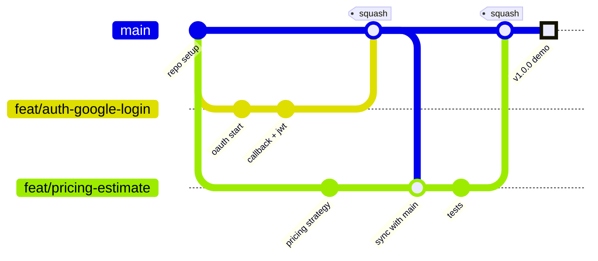

# Contributing to SwiftDrop

How our 10-person team works in one repository without stepping on each other.
**Read this once before your first commit.** It takes about 10 minutes and saves hours of
merge conflicts.

**Contents**

1. [The daily loop (TL;DR)](#1-the-daily-loop-tldr)
2. [First-time setup](#2-first-time-setup)
3. [Branches](#3-branches)
4. [Commits](#4-commits)
5. [Pull requests](#5-pull-requests)
6. [Code review](#6-code-review)
7. [Staying in sync and fixing conflicts](#7-staying-in-sync-and-fixing-conflicts)
8. [Shared "hot" files — extra care](#8-shared-hot-files--extra-care)
9. [Coding standards](#9-coding-standards)
10. [Definition of Done](#10-definition-of-done)
11. [Working together](#11-working-together)
12. [Oops — fixing common mistakes](#12-oops--fixing-common-mistakes)
13. [Demo and submission week](#13-demo-and-submission-week)
14. [Repo lead: one-time GitHub settings](#14-repo-lead-one-time-github-settings)

---

## 1. The daily loop (TL;DR)

```bash
# 1. Start from the latest main
git switch main
git pull

# 2. Create a branch for ONE small piece of work in your area
git switch -c feat/parcels-status-history

# 3. Work in small steps, commit often
git add -p                      # review what you're adding
git commit -m "feat(parcels): append status history on every change"

# 4. Bring in teammates' changes at least once a day
git fetch origin
git rebase origin/main          # or: git merge origin/main  (see §7)

# 5. Push and open a Pull Request (draft is fine early)
git push -u origin feat/parcels-status-history
```

Then: fill in the PR template → CI green → **one approval** → **Squash and merge** →
delete the branch.

**Golden rules**

1. 🚫 Never push directly to `main`.
2. 🔑 Never commit secrets (`.env`, keys, passwords, real phone numbers or addresses).
3. 📦 One branch = one small piece of work = one small PR.
4. 🔄 Pull/rebase from `main` every day.
5. 💬 Touching someone else's area or a shared file? Tell them first.

---

## 2. First-time setup

### Make sure your commits count as yours

The assignment requires each member to explain their contribution. GitHub only credits a
commit to you if its email matches your GitHub account.

```bash
git config --global user.name  "Your Name"
git config --global user.email "the-email-on-your-github-account@example.com"
```

Check it on GitHub after your first push — your avatar should appear next to the commit.

### Windows users: line endings

```bash
git config --global core.autocrlf input
```

The repo's `.gitattributes` keeps files as LF so shell scripts work inside Docker.

### Get the project running

```bash
git clone https://github.com/dilshanmolligoda/SwiftDrop.git
cd SwiftDrop
cp .env.example .env            # then fill in the <change-me> values
docker compose up -d --build
```

See the [README](README.md#getting-started) for URLs and running a single app with hot reload.

### Recommended VS Code extensions

ESLint · Prettier · EditorConfig · Prisma · Docker · GitLens ·
Markdown Preview Mermaid Support (to preview the diagrams).

---

## 3. Branches

We use **GitHub Flow**: one protected `main` that always works, plus short-lived branches.



### Naming

`<type>/<area>-<short-description>` — lowercase, hyphens, no spaces.

| Type | Use for | Example |
|---|---|---|
| `feat/` | New feature | `feat/merchant-api-keys` |
| `fix/` | Bug fix | `fix/tracking-sse-reconnect` |
| `test/` | Tests only | `test/courier-authorization` |
| `docs/` | Documentation / diagrams | `docs/er-diagram` |
| `chore/` | Tooling, deps, config | `chore/docker-compose-healthchecks` |
| `refactor/` | Restructure, no behaviour change | `refactor/pricing-engine` |

**Keep branches short-lived (1–3 days).** A branch that lives for two weeks becomes a
merge-conflict nightmare. If a feature is big, split it: e.g. `feat/webhooks-config`, then
`feat/webhooks-delivery`, then `feat/webhooks-retry`.

---

## 4. Commits

We use [Conventional Commits](https://www.conventionalcommits.org/):

```text
<type>(<scope>): <what changed, in present tense, lowercase>
```

```text
feat(parcels): validate status transitions with state machine
fix(auth): reject google login when email is not verified
test(courier): add 403 test for another courier's parcel
docs(architecture): add rabbitmq retry topology
chore(docker): add healthcheck to postgres
```

**Scopes:** `web`, `api`, `worker`, `auth`, `users`, `merchants`, `parcels`, `pricing`,
`dispatch`, `courier`, `tracking`, `reports`, `contracts`, `docker`, `k8s`, `ci`, `docs`, `ai`.

Tips:
- Commit when one small thing works — several commits per day is normal.
- Use `git add -p` to review each change before staging it. This is where you catch stray
  `console.log`s and secrets.
- PRs are squash-merged, so the **PR title** becomes the final commit on `main` — give it
  the same format.

---

## 5. Pull requests

1. **Open a draft PR early** (after your first push). Teammates can see what you're doing
   and spot clashes before they become conflicts.
2. **Keep it small:** aim for under ~400 changed lines. Big PRs get shallow reviews.
3. **Fill in the template:** what, why, how to test, screenshots for UI changes, sample
   request/response for API changes.
4. **Stay in your area:** a PR should only touch your own module's folders. If it has to
   change someone else's area, ask them first and mention them in the PR description.
5. **Mark "Ready for review"** when lint and tests pass. CODEOWNERS automatically requests
   the right reviewer.
6. **Merge rules:** CI green + 1 approval + branch up to date → **Squash and merge** →
   **Delete branch**.
7. **Whoever opened the PR merges it** after approval — not the reviewer.

---

## 6. Code review

**Reviewers — respond within 24 hours.** A PR waiting three days blocks the author and
everyone who depends on them. If you can't review, say so and reassign.

Check for:
- Does it do what the PR description says? Did you run it or at least read the test?
- Business logic in services, not controllers? Uses repositories, not raw Prisma in services?
- Role **and** ownership checks on new endpoints?
- Input validated with a DTO? Errors handled without leaking internals?
- Tests for the new logic? Personal data kept out of logs?
- No duplicated code that already exists somewhere else?

How to comment:
- Be specific and kind: *"This lets a courier update any parcel — can we check
  `parcel.courierId === user.id` here?"* — not *"wrong"*.
- Prefix optional suggestions with **nit:** so the author knows they're not blocking.
- Approve with small nits rather than blocking on style the linter can catch.

**Authors:** respond to every comment (fix it, or explain why not), then re-request review.

---

## 7. Staying in sync and fixing conflicts

### Update your branch daily

```bash
git fetch origin
git rebase origin/main
# fix conflicts if any, then:
git push --force-with-lease
```

`--force-with-lease` is safe: it refuses to overwrite if someone else pushed to your branch.
**Never force-push to `main`** (branch protection blocks it anyway).

Not comfortable with rebase? Merging is fine too:

```bash
git fetch origin
git merge origin/main
git push
```

Pick one way and stick to it on your branch.

### Resolving a conflict

1. `git status` shows the conflicted files.
2. Open each one; VS Code shows *Accept Current / Incoming / Both*. Keep what both people
   intended — usually **both** changes.
3. If it's someone else's code and you're unsure, **ask them** before choosing.
4. `git add <file>` then `git rebase --continue` (or `git commit` if merging).
5. Run the app and tests before pushing.

### `package-lock.json` conflict

Don't edit it by hand:

```bash
git checkout --theirs package-lock.json   # take main's version (during a rebase use --ours: sides are swapped)
npm install                               # regenerates it with your dependencies added
git add package-lock.json
```

---

## 8. Shared "hot" files — extra care

These files are touched by many people. Conflicts and breakages happen here first.

| File / folder | Rule |
|---|---|
| `packages/contracts/` | Never rename or remove a field others use. Add optional fields or a `V2` type. Tag affected owners in the PR. |
| `apps/api/prisma/` (schema + migrations) | Before `prisma migrate dev`, pull `main`. If `main` gets a new migration before yours merges: delete your migration folder, rebase, run `migrate dev` again. Post in the team chat when a migration merges. |
| `apps/api/src/app.module.ts` | Only add your module's import line. Keep the list alphabetical to reduce conflicts. |
| `docker-compose.yml`, `infra/` | Changes go through the DevOps owner. |
| `.env.example` | Add new variables with a comment. Never put real values. Announce new required variables. |
| `ARCHITECTURE.md`, `docs/diagrams/` | Update when behaviour changes; DevOps/docs owner reviews. |

---

## 9. Coding standards

**General**
- TypeScript `strict` mode everywhere. No `any` unless commented why.
- ESLint + Prettier decide style — run `npm run lint` before pushing. Don't argue about
  formatting in reviews.
- Names describe intent: `assignParcelToCourier()`, not `doIt()`; files in `kebab-case`.
- No commented-out code — Git remembers it.

**Backend (NestJS)**
- Controllers: routing + DTOs + guards only. Services: business rules. Repositories: data access.
- Every endpoint: `@Roles(...)` (or `@Public()`), a validated DTO, and an ownership check
  where the resource belongs to someone.
- Throw NestJS HTTP exceptions (`NotFoundException`, `ForbiddenException`, …) or domain
  errors mapped by the global filter. Never return stack traces or SQL errors.
- Config only through the config service reading env vars. **No hard-coded secrets, URLs or
  ports.**
- Use the logger, never `console.log`. Never log passwords, tokens, API keys, phone numbers
  or addresses.
- New status changes must go through the parcels service so the outbox event is written.

**Frontend (React)**
- Your role's screens live in `src/features/<role>/`.
- Call the API only through `src/api/` — no `fetch` scattered in components.
- Check the UI at mobile width (the tracking page especially).

**Tests**
- Every service method with business logic gets a unit test.
- Every new endpoint with a role or ownership rule gets an authorization test (allowed +
  forbidden case).
- Test names say the behaviour: `it('returns 403 when courier updates another courier's parcel')`.

---

## 10. Definition of Done

A task is **done** only when:

- [ ] Code merged to `main` through a reviewed PR
- [ ] Lint and all tests pass in CI
- [ ] Tests cover the new logic (incl. authorization where relevant)
- [ ] Works in `docker compose up` — not just on your machine
- [ ] New env vars in `.env.example`; README/ARCHITECTURE/diagrams updated if behaviour changed
- [ ] Swagger shows the new/changed endpoint with examples
- [ ] Your row in `docs/contribution-sheet.md` updated

---

## 11. Working together

- **Own your area.** Each member owns one area of the system (see the ownership table in
  the README): customer features, merchant features, courier, dispatch, DevOps and so on.
  Build, test and document your area end to end — you are the go-to person for it in the demo.
- **Pull before you start, push before you stop.** Begin every work session with
  `git switch main && git pull`, then update your branch (§7). End every session by pushing
  your branch, so your work is never stuck on one laptop.
- **Touching someone else's area?** Ask them first, and mention them in the PR.
- **Merge small and often.** A PR that stays open for a week will conflict with everything.
- **Short daily check-in** (chat is fine): *done yesterday / doing today / blocked by*.
- **Blocked for more than half a day? Say so.** Waiting silently is the most expensive
  thing a team can do.
- **API-first:** agree on an endpoint's request/response in the team chat (or Swagger) before
  building it. Then frontend and backend can work in parallel — frontend mocks the response
  until the real endpoint lands.
- **Pair on the tricky parts:** OAuth, outbox/RabbitMQ, SSE. Two people understanding each
  piece also helps everyone in the demo Q&A.
- **Decisions** that affect others → short note in `docs/adr/` + a line in the
  ARCHITECTURE.md decision log.

---

## 12. Oops — fixing common mistakes

| Problem | Fix |
|---|---|
| Committed to `main` locally by mistake | `git switch -c feat/my-work` (keeps your commits), then `git switch main && git reset --hard origin/main` |
| Wrong last commit message (not pushed) | `git commit --amend -m "new message"` |
| Want to undo uncommitted changes in a file | `git restore <file>` |
| Need to switch branch but have unfinished work | `git stash` … later `git stash pop` |
| Branch is a mess | `git fetch && git rebase origin/main`, or ask for help — don't delete others' work |
| **Pushed a secret** | 1) Tell the repo lead immediately. 2) **Rotate the secret** (new key/password) — removing it from Git history is not enough, it's already exposed. 3) Then clean history. |

---

## 13. Demo and submission week

- **Feature freeze 3 days before the demo:** only bug fixes and docs merge after that.
- Run the full demo script on a **fresh clone** with `docker compose up` on someone else's
  laptop.
- Tag the submitted version: `git tag -a v1.0.0 -m "Submission"` → `git push origin v1.0.0`.
- Generate coverage reports into `docs/reports/`.
- Everyone checks their row in `docs/contribution-sheet.md`.
- Everyone can explain: the architecture diagram, how a status change becomes a
  notification and a webhook, and their own module.

---

## 14. Repo lead: one-time GitHub settings

*For the repository owner, before inviting the team.*

1. **Settings → Collaborators:** invite all 9 members with *Write* access.
2. **Settings → Branches → Add rule** for `main`:
   - ✅ Require a pull request before merging — 1 approval
   - ✅ Dismiss stale approvals when new commits are pushed
   - ✅ Require review from Code Owners
   - ✅ Require status checks to pass (add the CI job once it exists)
   - ✅ Require branches to be up to date before merging
   - ✅ Require conversation resolution before merging
   - ❌ Allow force pushes · ❌ Allow deletions
3. **Settings → General → Pull Requests:** allow **squash merging** only;
   ✅ *Automatically delete head branches*.
4. **`.github/CODEOWNERS`:** replace the placeholder `@handles` with real usernames.
5. **README ownership table:** fill in each member's area so everyone knows who owns what.

> Branch protection on a **private** repo needs GitHub Pro — free with the
> [GitHub Student Developer Pack](https://education.github.com/pack). Until it's active,
> "never push directly to `main`" is a team rule.
