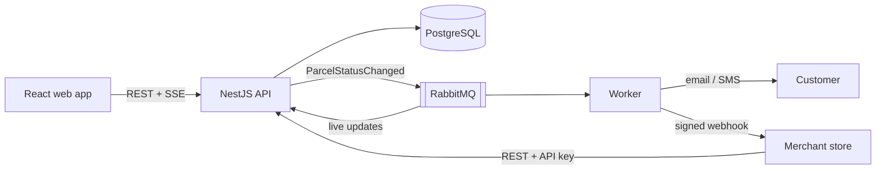

# SwiftDrop — Parcel Delivery & Courier Management System

Island-wide parcel booking, dispatching and **live tracking** for customers, partner
merchants, couriers and dispatchers — with a merchant API, webhooks and event-driven
notifications.


> 🚧 **Setup stage.** The repository structure, architecture and team workflow are in place.
> Each app folder has a README describing what goes there; services are being scaffolded.

---

## Table of contents

- [What it does](#what-it-does)
- [Tech stack](#tech-stack)
- [Architecture at a glance](#architecture-at-a-glance)
- [Repository structure](#repository-structure)
- [Getting started](#getting-started)
- [Environment variables](#environment-variables)
- [Running tests](#running-tests)
- [Documentation](#documentation)
- [Team and contributing](#team-and-contributing)
- [Project progress](#project-progress)

---

## What it does

| Role | Main features |
|---|---|
| **Customer** | Sign up / log in (incl. **Login with Google**) · create a delivery and see the fee first · **live tracking** · public tracking link · delivery history · PDF receipt |
| **Merchant** | Register (admin approval) · create orders through the **REST API with an API key** · receive **webhooks** on every status change · orders dashboard |
| **Courier** | Today's assigned deliveries · update status with note/photo proof · mark failed with a reason |
| **Dispatcher / Admin** | Assign parcels to couriers · courier workloads · manage users, merchants, zones and pricing · delivery reports |

Parcel lifecycle: `Created → Picked Up → In Transit → Out for Delivery → Delivered / Failed`

---

## Tech stack

| Layer | Technology |
|---|---|
| Frontend | React + TypeScript (Vite), responsive / mobile-first |
| Backend | NestJS (Node 22, TypeScript) — modular monolith |
| Database | PostgreSQL 16 + Prisma ORM |
| Messaging | RabbitMQ (topic exchange, retry + dead-letter queues) |
| Real-time | Server-Sent Events (SSE) |
| Auth | JWT (access + refresh) · Google OAuth 2.0 (PKCE) · merchant API keys |
| Notifications | Email via SMTP (Mailpit in dev) · mock SMS |
| Containers | Docker · Docker Compose |
| Bonus | Kubernetes + Helm · AI Delivery Assistant with MCP tools |
| Testing | Jest · Supertest · Testcontainers · Vitest + React Testing Library |

---

## Architecture at a glance



A status change is saved together with an **outbox** event in one transaction; the event is
then published to RabbitMQ, and the worker sends notifications and merchant webhooks (with
retries). Full details and justification: **[ARCHITECTURE.md](ARCHITECTURE.md)**.

---

## Repository structure

```text
swiftdrop/
├── apps/
│   ├── web/                # React + TS frontend (all roles + public tracking)
│   ├── api/                # NestJS backend — REST API, auth, business modules, SSE
│   ├── worker/             # NestJS consumers — notifications + merchant webhooks
│   └── ai-assistant/       # Bonus: AI chatbot + MCP tools
├── packages/
│   └── contracts/          # Shared TS types: enums, events, webhook payloads
├── tools/
│   └── mock-merchant/      # Demo merchant store (calls our API, receives webhooks)
├── infra/
│   ├── docker/             # nginx config, init scripts
│   ├── rabbitmq/           # exchanges / queues definitions
│   └── k8s/helm/swiftdrop/ # Bonus: Helm chart (ConfigMap, Secret, Services, Ingress)
├── docs/
│   ├── diagrams/           # Use case + sequence diagrams (Mermaid) + PNG exports
│   ├── adr/                # Architecture decision records
│   └── reports/            # Test results + coverage for submission
├── .github/                # PR template, CODEOWNERS (CI workflow coming)
├── .env.example            # Every environment variable, documented
├── docker-compose.yml      # Whole system locally (coming soon)
├── ARCHITECTURE.md
├── CONTRIBUTING.md         # Team workflow — read before your first commit
└── README.md
```

**Why this layout?** Each app is its own Docker image and its own owner area, so ten people
can work in parallel with few merge conflicts. Shared types live in one place
(`packages/contracts`) so the API, worker and frontend never disagree on data shapes.

---

## Getting started

### Prerequisites

| Tool | Version |
|---|---|
| [Git](https://git-scm.com/) | any recent |
| [Docker Desktop](https://www.docker.com/products/docker-desktop/) (includes Compose v2) | latest |
| [Node.js](https://nodejs.org/) | 22 LTS (`nvm use` reads `.nvmrc`) — only for running apps outside Docker |

### 1. Clone and configure

```bash
git clone https://github.com/dilshanmolligoda/SwiftDrop.git
cd SwiftDrop
cp .env.example .env        # Windows PowerShell: Copy-Item .env.example .env
```

Open `.env` and replace every `<change-me>`. For local use any random strings work, e.g.
`openssl rand -base64 48`. Ask the repo lead for the shared Google OAuth client ID if you
are working on Google login.

### 2. Run everything with Docker

```bash
docker compose up -d --build     # start all services
docker compose ps                # check they are healthy
docker compose logs -f api       # follow one service's logs
docker compose down              # stop (add -v to also wipe DB/broker data)
```

| Service | URL |
|---|---|
| Web app | <http://localhost:5173> |
| API | <http://localhost:3000/api/v1> |
| API docs (Swagger) | <http://localhost:3000/api/docs> |
| RabbitMQ management | <http://localhost:15672> (user/pass from `.env`) |
| Mailpit — see sent emails | <http://localhost:8025> |
| Mock merchant store | <http://localhost:4000> |
| AI assistant (bonus) | <http://localhost:3100> |

### 3. Run one app locally (faster while coding)

Keep the infrastructure in Docker and run your app with hot reload:

```bash
docker compose up -d postgres rabbitmq mailpit   # infrastructure only
npm install                                      # once, from the repo root
npm run dev:api        # or dev:web / dev:worker
```

When running outside Docker, use `localhost` instead of the service names in `.env`
(e.g. `POSTGRES_HOST=localhost`).

### Demo accounts

Seeded by the database seed script (to be added):

| Role | Email | Password |
|---|---|---|
| Admin | `admin@swiftdrop.local` | see seed script |
| Courier | `courier1@swiftdrop.local` | see seed script |
| Customer | `customer@swiftdrop.local` | see seed script |
| Merchant | `merchant@swiftdrop.local` | see seed script |

---

## Environment variables

All variables are documented in **[.env.example](.env.example)**. Main groups:

| Group | Examples | Used by |
|---|---|---|
| Database | `POSTGRES_*`, `DATABASE_URL` | api, worker |
| Broker | `RABBITMQ_URL`, `RABBITMQ_EVENTS_EXCHANGE` | api, worker |
| Auth | `JWT_ACCESS_SECRET`, `JWT_REFRESH_SECRET`, `GOOGLE_CLIENT_*` | api |
| Merchant integration | `API_KEY_PEPPER`, `WEBHOOK_*` | api, worker |
| Notifications | `SMTP_*`, `SMS_PROVIDER` | worker |
| Frontend | `VITE_API_BASE_URL` (public!) | web |
| AI assistant | `LLM_PROVIDER`, `LLM_MODEL`, `LLM_API_KEY` | ai-assistant |

**Rules:** never commit `.env`; never hard-code a secret; anything starting with `VITE_` is
visible in the browser. Adding a variable? Add it to `.env.example` in the same PR.

---

## Running tests

```bash
npm test                         # all workspaces
npm run test:cov                 # with coverage
npm test -w apps/api             # one app
```

Integration tests start real PostgreSQL and RabbitMQ containers (Testcontainers), so Docker
must be running. Coverage reports for submission go in [`docs/reports/`](docs/reports/README.md).

---

## Documentation

| Document | What's inside |
|---|---|
| [ARCHITECTURE.md](ARCHITECTURE.md) | Architecture style + justification, containers, layers, modules, integration patterns, RabbitMQ topology, security, data model, API conventions, design patterns, deployment, testing |
| [docs/diagrams/use-case.md](docs/diagrams/use-case.md) | Use case diagrams — overview + one per actor |
| [docs/diagrams/sequence-customer.md](docs/diagrams/sequence-customer.md) | Registration, Google OAuth, create delivery, live tracking, receipt |
| [docs/diagrams/sequence-merchant.md](docs/diagrams/sequence-merchant.md) | Merchant onboarding, API order creation, webhooks with retry |
| [docs/diagrams/sequence-courier.md](docs/diagrams/sequence-courier.md) | Status update → outbox → RabbitMQ → notifications + webhooks |
| [docs/diagrams/sequence-dispatcher.md](docs/diagrams/sequence-dispatcher.md) | Approval, assignment, management, reports |
| [CONTRIBUTING.md](CONTRIBUTING.md) | How we work together in this repo |

---

## Team and contributing

**Before your first commit, read [CONTRIBUTING.md](CONTRIBUTING.md).** Short version:

1. Work only in **your own area** (table below). Touching someone else's? Ask them first.
2. Before you start: `git switch main && git pull`, then `git switch -c feat/<area>-<short-name>`.
3. Small commits using `type(scope): message` (e.g. `feat(parcels): add status history`).
4. Open a PR early, fill in the template, get **one approval**, squash-merge.

| Area | Owner(s) |
|---|---|
| Repo, DevOps, documentation, architecture | `@dilshanmolligoda` |
| Frontend | `@…` `@…` |
| Auth + Google OAuth | `@…` |
| Parcels, tracking + SSE | `@…` |
| Pricing + zones | `@…` |
| Dispatch + courier | `@…` |
| Merchants, API keys + webhooks | `@…` |
| Worker, RabbitMQ, notifications | `@…` |
| Testing + coverage | `@…` |
| Kubernetes + AI assistant (bonus) | `@…` |

Full per-member responsibilities for submission: `docs/contribution-sheet.md`.

---

## Project progress

**DevOps + documentation**
- [x] Repository structure
- [x] README
- [x] Architecture documentation
- [x] Use case + sequence diagrams
- [x] Integration diagrams (in ARCHITECTURE.md)
- [x] Environment variables (`.env.example`)
- [ ] Dockerfiles (web, api, worker, ai-assistant, mock-merchant)
- [ ] `docker-compose.yml` (frontend, backend, database, RabbitMQ, Mailpit)
- [ ] Deployment configuration (Helm chart)
- [ ] CI workflow (lint, test, coverage, image build)

**Core features** — each owner keeps their own area's progress up to date here.

---

*Academic group project — Enterprise Application Development.*
