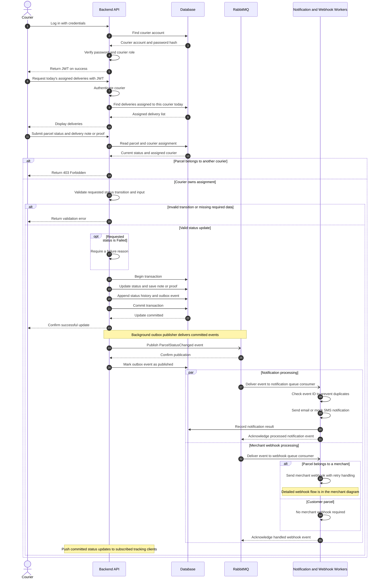
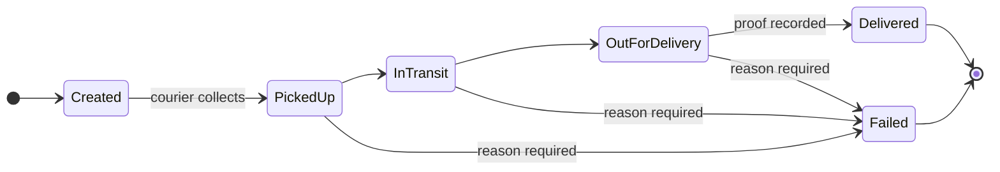

# Sequence Diagram — Courier

Covers: courier login, today's assigned deliveries, **status update with proof**, failed
delivery with reason, and how one status update **triggers notifications and merchant
webhooks** through RabbitMQ using the transactional outbox.

← [Back to diagram index](README.md)

## Allowed status transitions

The API rejects any update that is not in this state machine (step "Validate requested
status transition"). *Proposed — the parcels module owner confirms the final rules.*

## Design notes

| Step | Decision | Why |
|---|---|---|
| Ownership check | `403` if the parcel is assigned to a different courier | Assignment requirement: "a courier cannot access another courier's deliveries" — covered by a test |
| Transaction | Status, history row and outbox event saved in **one** DB transaction | The event is never lost and never sent for an update that rolled back |
| Outbox publisher | Background job publishes and marks rows as published | Decouples the HTTP request from broker availability |
| Two queues | Notification and webhook consumers get their own copy of the event | A failing webhook can't delay customer notifications |
| Idempotency | Consumers skip event IDs they have already processed | RabbitMQ is at-least-once; duplicates must be harmless |
| Proof upload | Image type/size validated; stored outside the DB; path saved | Keeps the DB small; prevents uploading arbitrary files |
