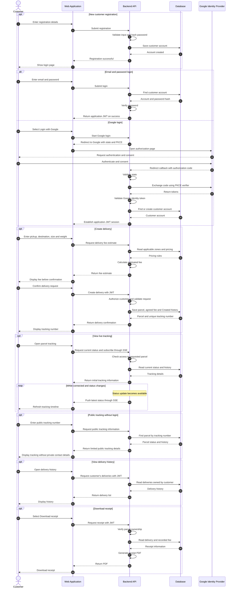

# Sequence Diagram — Customer

Covers: registration, email/password login, **Login with Google (OAuth 2.0 + PKCE)**,
**creating a delivery** with fee estimate, live tracking over **SSE**, public tracking,
delivery history and receipt download.

← [Back to diagram index](README.md)

## Design notes

| Step | Decision | Why |
|---|---|---|
| Registration | Password hashed (bcrypt/argon2) before saving | Plain passwords never reach the database |
| Google login | Authorization Code flow with `state` + PKCE, handled by the backend | Prevents CSRF and code interception; the client secret never reaches the browser |
| Google login | Backend issues **our own** JWT after verifying Google's ID token | All roles use the same JWT + RBAC checks afterwards |
| Create delivery | Fee is recalculated on the server and stored with the parcel | The client cannot change the price; the receipt shows the agreed fee |
| Live tracking | SSE (one-way server → browser) | Simpler than WebSockets for status pushes; auto-reconnects |
| Public tracking | Limited response (status + timeline, no names/phones/addresses) | Protects personal data on an unauthenticated page |
| Receipt | Ownership check before generating the PDF | A customer can't download another customer's receipt |
