# Sequence Diagram — Dispatcher / Admin

Covers: admin login, **merchant approval**, **assigning a parcel to a courier** (with
conflict handling), courier workloads, user/merchant/zone/pricing management and reports.

← [Back to diagram index](README.md)

```mermaid
sequenceDiagram
    autonumber
    actor Admin as Dispatcher / Admin
    participant UI as Admin Dashboard
    participant API as Backend API
    participant DB as Database

    Admin->>UI: Enter login credentials
    UI->>API: Submit login
    API->>DB: Read user account
    DB-->>API: Account, password hash and role
    API->>API: Verify credentials and role
    API-->>UI: Return JWT on success
    UI-->>Admin: Display dashboard

    Note over UI,API: Every protected request is authenticated and authorized

    opt Approve merchant registration
        Admin->>UI: Open pending merchants
        UI->>API: Request pending registrations
        API->>DB: Read pending merchants
        DB-->>API: Pending merchant list
        API-->>UI: Return registrations
        UI-->>Admin: Display pending merchants

        Admin->>UI: Approve selected merchant
        UI->>API: Submit merchant approval
        API->>DB: Set merchant status to Approved
        DB-->>API: Approval saved
        API-->>UI: Confirm approval
        UI-->>Admin: Display approved status
    end

    opt Assign delivery to courier
        Admin->>UI: Open dispatch screen

        par Load unassigned parcels
            UI->>API: Request unassigned parcels
            API->>DB: Find parcels without courier assignments
            DB-->>API: Unassigned parcels
            API-->>UI: Return parcels
        and Load courier workloads
            UI->>API: Request courier workloads
            API->>DB: Count active deliveries per courier
            DB-->>API: Courier workload totals
            API-->>UI: Return workloads
        end

        UI-->>Admin: Display parcels and available couriers
        Admin->>UI: Select parcel and courier
        UI->>API: Submit assignment
        API->>API: Validate courier and assignment request
        API->>DB: Atomically assign parcel if still unassigned

        alt Parcel was already assigned
            DB-->>API: Assignment conflict
            API-->>UI: Return 409 Conflict
            UI-->>Admin: Refresh parcel and workload information
        else Assignment succeeds
            DB-->>API: Assignment saved
            API-->>UI: Confirm assignment
            UI-->>Admin: Update parcel list and courier workload
            Note over API,DB: Delivery appears when courier refreshes assigned deliveries
        end
    end

    opt Manage users
        Admin->>UI: Add or update user
        UI->>API: Submit user changes
        API->>API: Validate permitted changes
        API->>DB: Save user changes
        DB-->>API: Changes saved
        API-->>UI: Confirm update
    end

    opt Manage merchants
        Admin->>UI: Update merchant details or account status
        UI->>API: Submit merchant changes
        API->>API: Validate merchant changes
        API->>DB: Save merchant changes
        DB-->>API: Changes saved
        API-->>UI: Confirm update
    end

    opt Manage delivery zones and pricing
        Admin->>UI: Edit delivery zones or pricing rules
        UI->>API: Submit configuration changes
        API->>API: Validate zones and pricing
        API->>DB: Save updated configuration
        DB-->>API: Configuration saved
        API-->>UI: Confirm update
        UI-->>Admin: Display updated zones and prices
    end

    opt View reports
        Admin->>UI: Select report date range
        UI->>API: Request delivery statistics
        API->>DB: Aggregate daily deliveries and outcomes
        DB-->>API: Delivery, success and failure totals
        API->>API: Calculate success and failure rates
        API-->>UI: Return report data
        UI-->>Admin: Display report
    end
```

## Design notes

| Step | Decision | Why |
|---|---|---|
| Parallel loading | Parcels and workloads fetched at the same time | Faster dispatch screen |
| Atomic assignment | `UPDATE ... SET courier_id = ? WHERE id = ? AND courier_id IS NULL` | Two dispatchers can't assign the same parcel; the loser gets `409 Conflict` |
| Workloads | Count of parcels in active states per courier | Helps spread deliveries evenly |
| Pricing changes | New rules apply to new parcels only | Existing parcels keep the fee the customer agreed to |
| Reports | Aggregated in SQL, rates computed in the service | Keeps report logic in the business layer and testable |
