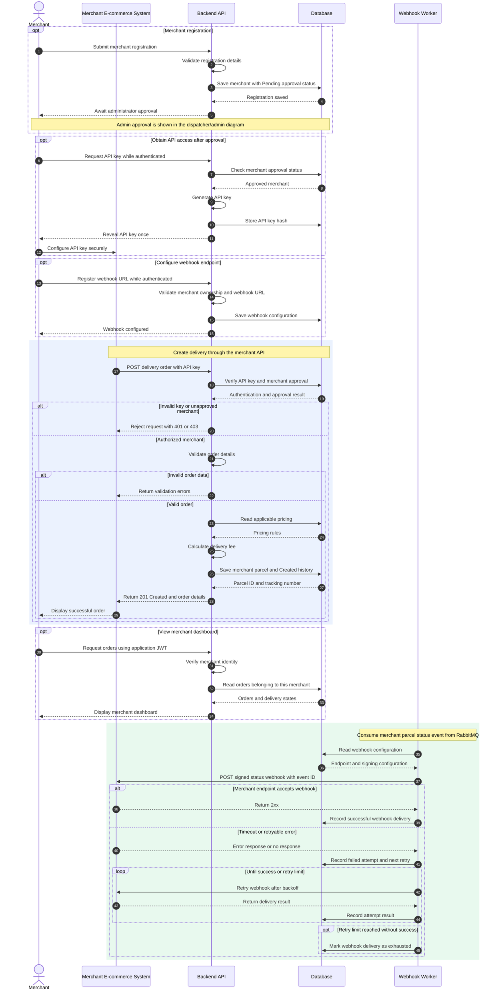

# Sequence Diagram — Merchant

Covers: merchant registration (pending approval), issuing an **API key**, configuring a
webhook URL, **creating a delivery order through the merchant API**, the merchant
dashboard, and **webhook delivery with retry**.

← [Back to diagram index](README.md)

**Blue block** = synchronous request/reply (merchant API).
**Green block** = asynchronous publish/subscribe (webhook worker).

## Design notes

| Step | Decision | Why |
|---|---|---|
| API key | Shown **once**, only a hash is stored | A database leak doesn't expose usable keys |
| API key | Sent in `X-API-Key` header over HTTPS | Keeps keys out of URLs and access logs |
| Order creation | `401` bad key, `403` not approved, `422` invalid body | Clear, standard errors with no internal details |
| Order creation | Optional `Idempotency-Key` header | A store that retries a timed-out request doesn't create duplicate parcels |
| Webhook | Signed with HMAC-SHA256 (`X-SwiftDrop-Signature`) + `X-SwiftDrop-Event-Id` | Merchant can verify it came from us and ignore duplicates |
| Webhook retry | Exponential backoff, max attempts from `WEBHOOK_MAX_ATTEMPTS`, then dead-letter | A merchant outage doesn't lose events or block other merchants |
| Webhook log | Every attempt stored | Visible in the merchant dashboard and useful in the demo |
