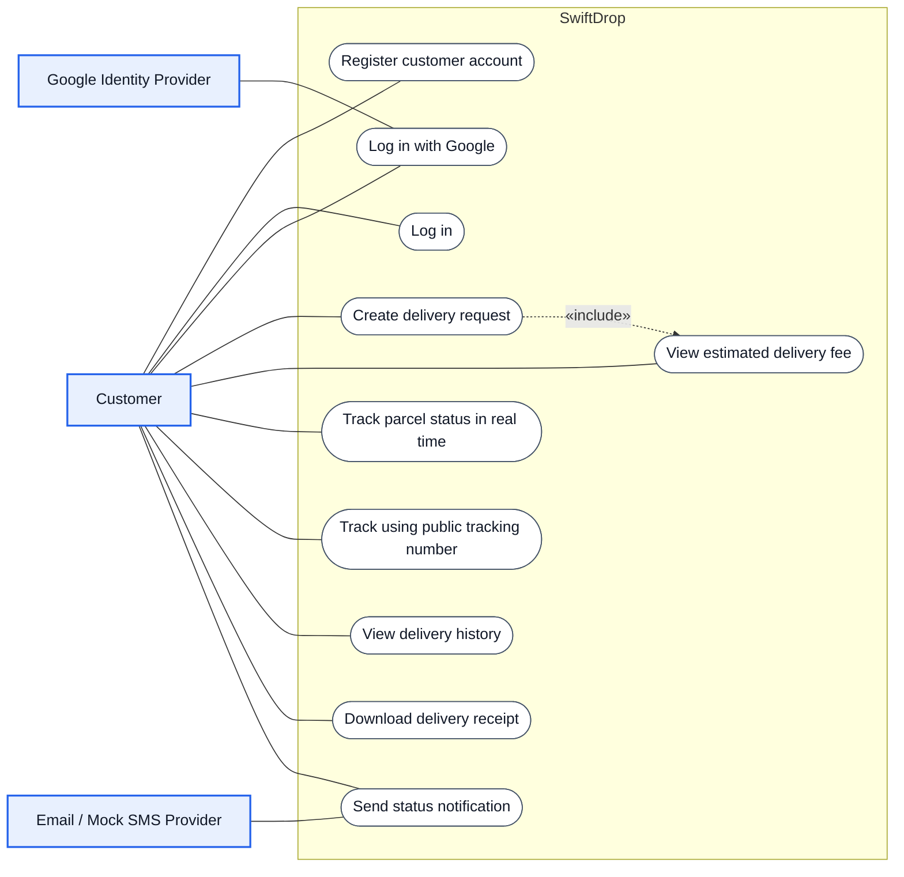
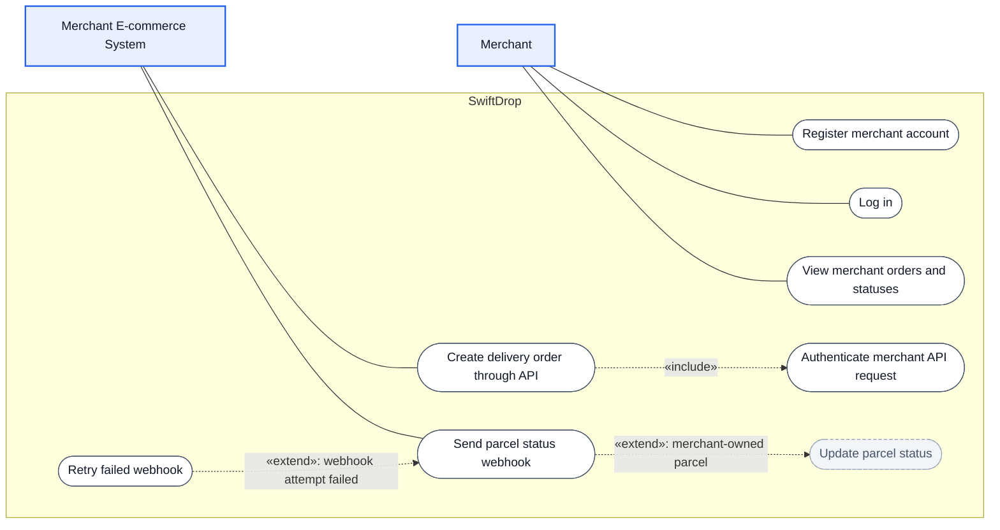
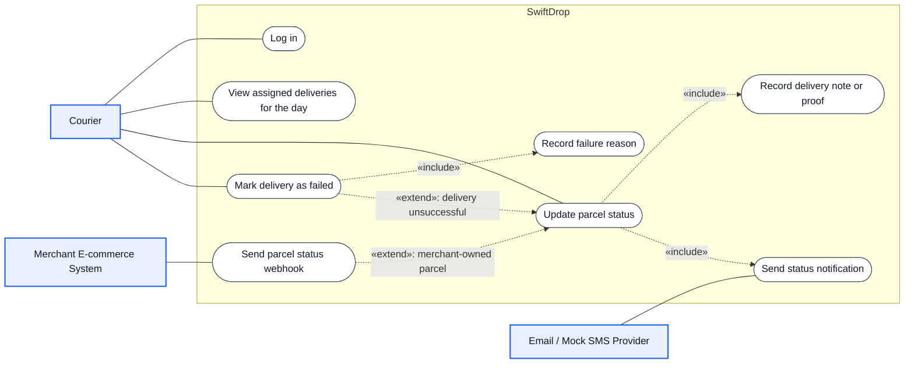
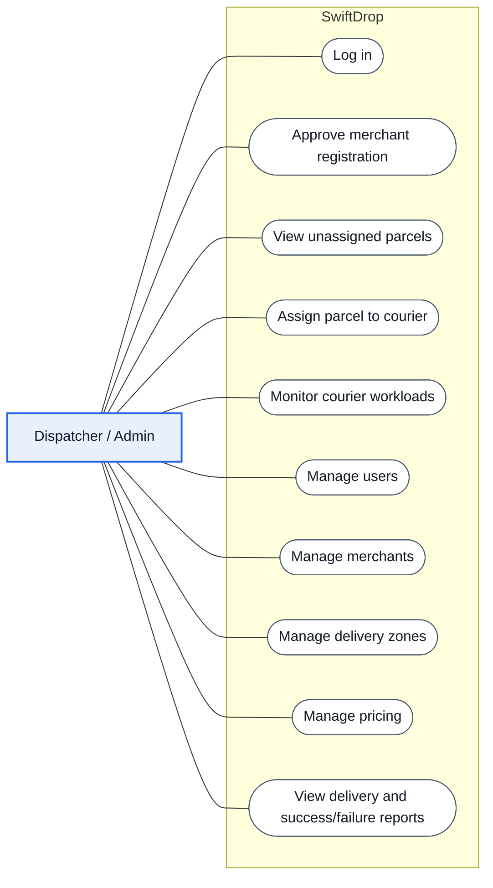

# Use Case Diagrams

> GitHub renders these Mermaid diagrams automatically. To edit one, paste the code block
> into <https://mermaid.live>, change it, and paste it back.

**Contents**

1. [System overview (all actors)](#1-system-overview-all-actors)
2. [Customer](#2-customer)
3. [Merchant](#3-merchant)
4. [Courier](#4-courier)
5. [Dispatcher / Admin](#5-dispatcher--admin)
6. [Notation](#notation)

---

## 1. System overview (all actors)

The full picture: every actor, every use case, grouped by functional area.

```mermaid
flowchart TB
    Customer["Customer"]
    Merchant["Merchant"]
    Courier["Courier"]
    Admin["Dispatcher / Admin"]
    Google["Google Identity Provider"]
    MerchantSystem["Merchant E-commerce System"]
    NotificationProvider["Email / Mock SMS Provider"]

    subgraph SwiftDrop["SwiftDrop — Parcel Delivery and Courier Management System"]
        direction TB

        subgraph Access["Account and Access"]
            Register(["Register customer account"])
            Login(["Log in"])
            GoogleLogin(["Log in with Google"])
            MerchantRegister(["Register merchant account"])
            ApproveMerchant(["Approve merchant registration"])
        end

        subgraph CustomerFeatures["Customer Features"]
            CreateDelivery(["Create delivery request"])
            EstimateFee(["View estimated delivery fee"])
            TrackParcel(["Track parcel status in real time"])
            PublicTracking(["Track using public tracking number"])
            DeliveryHistory(["View delivery history"])
            DownloadReceipt(["Download delivery receipt"])
        end

        subgraph MerchantFeatures["Merchant Features"]
            APIOrder(["Create delivery order through API"])
            AuthenticateAPI(["Authenticate merchant API request"])
            MerchantDashboard(["View merchant orders and statuses"])
            SendWebhook(["Send parcel status webhook"])
            RetryWebhook(["Retry failed webhook"])
        end

        subgraph CourierFeatures["Courier Features"]
            AssignedDeliveries(["View assigned deliveries for the day"])
            UpdateStatus(["Update parcel status"])
            RecordProof(["Record delivery note or proof"])
            FailedDelivery(["Mark delivery as failed"])
            FailureReason(["Record failure reason"])
            Notify(["Send status notification"])
        end

        subgraph AdminFeatures["Dispatcher and Admin Features"]
            UnassignedParcels(["View unassigned parcels"])
            AssignCourier(["Assign parcel to courier"])
            Workloads(["Monitor courier workloads"])
            ManageUsers(["Manage users"])
            ManageMerchants(["Manage merchants"])
            ManageZones(["Manage delivery zones"])
            ManagePricing(["Manage pricing"])
            Reports(["View delivery and success/failure reports"])
        end
    end

    %% Customer associations
    Customer --- Register
    Customer --- Login
    Customer --- GoogleLogin
    Customer --- CreateDelivery
    Customer --- EstimateFee
    Customer --- TrackParcel
    Customer --- PublicTracking
    Customer --- DeliveryHistory
    Customer --- DownloadReceipt
    Customer --- Notify

    %% Merchant associations
    Merchant --- MerchantRegister
    Merchant --- Login
    Merchant --- MerchantDashboard
    MerchantSystem --- APIOrder
    MerchantSystem --- SendWebhook

    %% Courier associations
    Courier --- Login
    Courier --- AssignedDeliveries
    Courier --- UpdateStatus
    Courier --- FailedDelivery

    %% Dispatcher and admin associations
    Admin --- Login
    Admin --- ApproveMerchant
    Admin --- UnassignedParcels
    Admin --- AssignCourier
    Admin --- Workloads
    Admin --- ManageUsers
    Admin --- ManageMerchants
    Admin --- ManageZones
    Admin --- ManagePricing
    Admin --- Reports

    %% External service associations
    Google --- GoogleLogin
    NotificationProvider --- Notify

    %% Required behavior
    CreateDelivery -.->|"«include»"| EstimateFee
    APIOrder -.->|"«include»"| AuthenticateAPI
    UpdateStatus -.->|"«include»"| RecordProof
    UpdateStatus -.->|"«include»"| Notify
    FailedDelivery -.->|"«include»"| FailureReason

    %% Conditional behavior
    FailedDelivery -.->|"«extend»: delivery unsuccessful"| UpdateStatus
    SendWebhook -.->|"«extend»: merchant-owned parcel"| UpdateStatus
    RetryWebhook -.->|"«extend»: webhook attempt failed"| SendWebhook

    classDef actor fill:#e8f0fe,stroke:#2563eb,stroke-width:2px,color:#111827
    classDef usecase fill:#ffffff,stroke:#475569,stroke-width:1px,color:#111827

    class Customer,Merchant,Courier,Admin,Google,MerchantSystem,NotificationProvider actor
    class Register,Login,GoogleLogin,MerchantRegister,ApproveMerchant usecase
    class CreateDelivery,EstimateFee,TrackParcel,PublicTracking,DeliveryHistory,DownloadReceipt usecase
    class APIOrder,AuthenticateAPI,MerchantDashboard,SendWebhook,RetryWebhook usecase
    class AssignedDeliveries,UpdateStatus,RecordProof,FailedDelivery,FailureReason,Notify usecase
    class UnassignedParcels,AssignCourier,Workloads,ManageUsers,ManageMerchants,ManageZones,ManagePricing,Reports usecase
```

The overview is large, so the four views below show **one primary actor each** — easier to
read and to explain in the demo. Use case names are identical to the overview.

---

## 2. Customer

**Key points**
- The fee estimate is always shown before a delivery is confirmed («include»).
- Public tracking needs no login and shows no private contact details.

---

## 3. Merchant

**Key points**
- A merchant can only use the API after an admin approves the registration (see the
  Dispatcher / Admin view).
- *Update parcel status* (dashed, grey) is performed by the courier; it is shown here only
  because the webhook use case extends it.
- The **Merchant E-commerce System** is a separate actor from the human merchant: it calls
  our API with an API key and receives our webhooks.

---

## 4. Courier

**Key points**
- Every status update always triggers a notification («include»).
- A merchant webhook is sent only when the parcel belongs to a merchant («extend»).
- A courier can only see and update parcels assigned to them.

---

## 5. Dispatcher / Admin

---

## Notation

| Symbol | Meaning |
|---|---|
| Blue box | Actor (a person or an external system) |
| Rounded white box | Use case |
| Solid line | Actor takes part in the use case |
| Dashed arrow `«include»` | The base use case **always** performs the target |
| Dashed arrow `«extend»: condition` | The source use case **optionally** adds behaviour to the target when the condition is true |
| Dashed grey box | Use case shown only for context (owned by another actor) |
